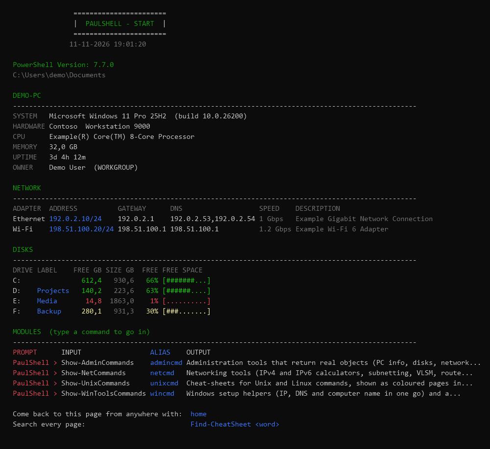
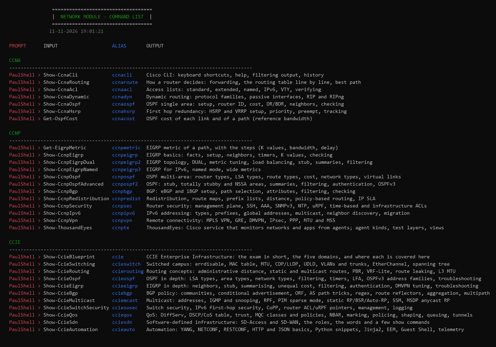
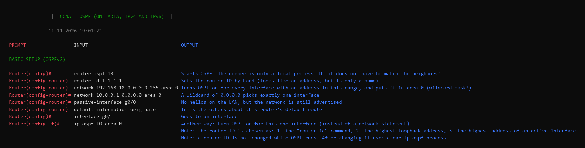
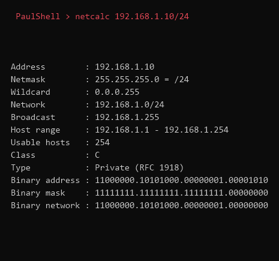

# Terminal Pro

A portable **PowerShell 7** setup for Windows, with a start page, a library of cheat-sheets (Cisco CCNA, CCNP and CCIE, Unix, Windows) and small admin and network tools that return real objects.

It lives in **one folder** and comes out again with **one command**.


*A short walkthrough with made-up data: the start page, `netcalc`, and a port check. (Generated by `docs/New-DemoGif.ps1` - nothing private in it.)*



*The start page. Your PC, network and disks at a glance, and a menu of every module. Type `home` from anywhere to come back to it. (This picture uses made-up data.)*

## Quick start

You need Windows 10 or 11 with [Windows Terminal](https://aka.ms/terminal) and an internet connection. You do not need admin rights.

```powershell
git clone https://github.com/MaskedMonsterMechanic/TerminalPro.git
cd TerminalPro
.\install.ps1 -WhatIf     # first look: lists every step and changes nothing
.\install.ps1             # installs
```

Then open a new Windows Terminal tab. To remove everything and get your old Terminal settings back:

```powershell
& "$env:LOCALAPPDATA\TerminalPro\uninstall.ps1"
```

If `install.ps1` is blocked by the execution policy, start it with `powershell -ExecutionPolicy Bypass -File .\install.ps1`. Run it from the project folder.

## What you get

### A start page and a menu of modules

Every new tab opens the start page above. Under the overview there is a list of all modules with the command that opens each one. Every page ends with a line that leads back (`home`).

### Cheat-sheets that look like a terminal

Each module has a command list (`netcmd`, `unixcmd`, `admincmd`, `wincmd`). The Network module has pages for CCNA, CCNP and CCIE:



Each page is a table of the **prompt**, the **input** you type and the **output** or meaning, so you can read it and copy from it:



Search every page at once with `Find-CheatSheet udld`. The pages are plain text files (`modules/Network/Sheets`), so you can add your own.

### Tools that return real objects

The calculators and admin tools return objects, so you can sort, filter and export what they give you:



```powershell
netcalc 192.168.1.10/24                       # subnet details, with binary
netvlsm 10.0.0.0/24 100,50,20                 # the smallest subnet for each group of hosts
aping pc1, pc2, pc3                           # which of these answer?
Get-PCInfo -ComputerName SRV01 | Select-Object Name, OS, Uptime
Get-Help netsum -Examples                     # every tool has help and examples
```

### The modules

| Module | Commands | What it is |
|---|---|---|
| **Network** | 66 | IPv4 and IPv6 calculators, VLSM, route summary, device setup and troubleshooting pages, theory, and the CCNA, CCNP and CCIE pages. `netcmd` |
| **AdminTools** | 21 | PC info, disks, network adapters, ping and DNS for many hosts, service restart, scheduled tasks, Hyper-V, remoting, Active Directory, a page on looking after servers from your own PC (`adsrv`), and build recipes (`adbuild`: a new domain, `addns`: DNS from one table, `addhcp`: DHCP scopes and failover, `adusers`: OUs, users and groups from tables, `adfiles`: file servers with shares, DFS and quotas). `admincmd` |
| **Unix** | 8 | Cheat-sheets for Unix and Linux: files, text, users, network, system. `unixcmd` |
| **Markdown** | 4 | Cheat-sheets for writing Markdown: the basics, lists and links, code and tables, and the extras GitHub adds. `mdcmd` |
| **WinTools** | 6 | Set IP address, DNS and computer name in one go, common Windows commands, how to install programs from the terminal (`winpkg`), and a list of free, checked programs you can install with one command (`winapps`, `wininst`). `wincmd` |
| **TerminalPro.Core** | 5 | The shared engine: start page, cheat-sheet pages, search, `Write-Color`. |

### Install the programs you need

A short list of well-known **free** programs (VS Code, Git, Nmap, Wireshark, PuTTY, TreeSize, WinDirStat, Sysinternals and more) that you can install from the terminal, using winget:

```powershell
winapps                          # the list, by category
winapps -Category Network        # only one category
wininst nmap, treesize -WhatIf   # shows what would be installed, installs nothing
wininst nmap, treesize           # installs them
```

What keeps it safe:

- It only installs programs that are **in the list** (`modules/WinTools/Data/apps.psd1`). You cannot type a random name or address.
- Every entry names the exact winget package id, the publisher, the licence and the home page. Before each install the tool asks winget who publishes that id and **refuses if the publisher is not the one in the list**.
- Programs come from the official winget source only, and winget checks the installer hash itself. Nothing is run from a web address.
- `-WhatIf` shows what would happen, and every install can be confirmed (`-Confirm`).
- "Free" here means free to use. The licence is shown in the list; check it before you use a program at work (some are free for personal use only).

To add a program, copy one entry in `apps.psd1`, fill it in from `winget show --id <id> -e`, and run the tests.

### Scripts, and where AI fits in

The cheat-sheets show you what to type. The tools return objects you can pipe. A short script in `scripts/` is what you write when the same job has to run on many hosts, many times: look it up on a page, try it once, then wrap the loop. That recursive loop of repeatable work is what admin life is made of.

PaulShell is the precursor. AI is complementary: use it in the terminal to turn a page (`adsrv`, `adbuild`, `addns`, …) into the script you need. You do not need a massive library of scripts here. One useful example is enough to show the pattern:

```powershell
.\scripts\Lab-HealthCheck.ps1
.\scripts\Lab-HealthCheck.ps1 dc01, file01 -Remoting
.\scripts\Lab-HealthCheck.ps1 -Path .\scripts\servers.example.txt -Remoting | Format-Table
.\scripts\Client-NetCheck.ps1
.\scripts\Client-NetCheck.ps1 dc01 -Port 80, 443, 3389
```

`Lab-HealthCheck.ps1` mixes `Resolve-HostList`, `Test-HostList` and `Get-PCInfo`. `Client-NetCheck.ps1` mixes `Get-NetIPAdapter` and `Test-TcpPort` (runnable with no args: your adapters, then your gateway on a few ports). See `scripts/README.md`.

## What the installer does

- Downloads the latest **PowerShell 7** straight from Microsoft's official release page (github.com/PowerShell/PowerShell), checks it against the published SHA256, and makes it the first terminal. Nothing from Microsoft is stored in this repo, and running the installer again does not download it again if you already have the latest version.
- Sets up **Windows Terminal**: PowerShell, Windows PowerShell, Command Prompt and Azure Cloud Shell, each with its own image.
- Downloads the **help files** for PowerShell 7 (into its own folder, so uninstall removes them), so `Get-Help` works from the first window. Skip it with `-SkipHelp`.
- Saves your favourite **modules** (see `modules.psd1`). A module that is already saved is skipped when you run the installer again; `-UpdateModules` fetches it again (close other PowerShell windows first, because Windows cannot replace a module that is loaded).
- Loads your **profile**: aliases, prompt, start page.

## Easy in, easy out

- Everything lives in one folder: `%LOCALAPPDATA%\TerminalPro`.
- The only file outside it is Windows Terminal's own `settings.json`. It is backed up first, and `uninstall.ps1` puts it back.
- No admin rights, no registry, no Program Files, nothing written to `Documents`.

```powershell
.\install.ps1 -WhatIf     # shows every step, changes nothing
.\install.ps1             # installs
& "$env:LOCALAPPDATA\TerminalPro\uninstall.ps1"   # removes it and restores your settings
```

Windows PowerShell 5.1 keeps its help in a system folder, so it needs one `Update-Help` in an administrator window (`Start-AdminShell -WindowsPowerShell` opens one). The installer does not do that for you: it never asks for admin rights.

## Make it yours

Everything personal is in plain text files. Change them before you install (or change them and install again: install is safe to repeat).

| You want to change | Where | How |
|---|---|---|
| **The name in the prompt** (`PaulShell >`) | `profile/profile.ps1` | Change the text in `$global:TerminalProPromptName = 'PaulShell'`. An administrator window shows `<name>Admin >`. The same name is shown on the cheat-sheet pages. Type `posh` to reload the profile. |
| **The pictures** (one per Windows Terminal profile) | `terminal/images/` and `terminal/settings.template.json` | Put your picture in `terminal/images/`. In the template, change the `backgroundImage` line of a profile to `{{HOME}}\\images\\your-picture.png`. Leave `{{HOME}}` as it is: the installer fills in the install folder. A PNG with a transparent background looks best. |
| **How faint the pictures are** | `terminal/settings.template.json` | `backgroundImageOpacity` (0.1 is 10%), `backgroundImageAlignment` and `opacity` of each profile. |
| **Which shells open in Terminal** | `terminal/settings.template.json` | Edit the `list`: `name`, `commandline`, and a `guid`. A new profile needs its own new GUID (`[guid]::NewGuid()`). `defaultProfile` at the top holds the GUID of the profile that opens first. |
| **Colours and font** | `terminal/settings.template.json` | `schemes` (the colours) and `font` under `profiles.defaults`. |
| **What the start page shows** | `profile/profile.ps1` | `$global:TerminalProStartInfo` lists the commands whose output is shown under the header (PC info, network adapters, disks). Under it comes a menu of every installed module. Type `home` anywhere to come back to it: every module page ends with a `home` line. |
| **Aliases and start page** | `profile/profile.ps1` | The `Set-Alias` lines and the "Start page" part at the bottom. |
| **Which modules are installed** | `modules.psd1` | Set `Enabled = $true` or `$false`. |

After a change, look at what the installer would do: `.\install.ps1 -WhatIf`. To go back to your old terminal: run `uninstall.ps1`.

## The Network module (cheat-sheets and calculators)

Type `netcmd` for the list. Pages and tools are grouped:

| Group | What is in it | Examples |
|---|---|---|
| Basics | Lab setup, DHCP, NAT, VLANs, troubleshooting, ports, acronyms | `netbc`, `netdhcp`, `netpn -Filter ssh` |
| CCNA | CLI, routing, ACLs, dynamic routing, OSPF, HSRP | `ccnacli`, `ccnaospf` |
| CCNP | EIGRP, OSPF, BGP, redistribution, security, IPv6, VPN, ThousandEyes | `ccnpbgp`, `ccnpvpn`, `ccnpte` |
| CCIE | Switching, routing, OSPF, EIGRP, BGP policy, multicast, security, QoS, SD-Access/SD-WAN, automation | `ccie` (the map), `cciebgp` |
| Tools | Subnet and IPv6 calculators, VLSM, summaries, EIGRP metric, OSPF cost | `netcalc 192.168.1.0/26`, `ccnpmetric -Link GigabitEthernet,Serial` |

Search every page: `Find-CheatSheet udld`. The pages are plain text files in `modules/Network/Sheets`, so you can add your own.
The Cisco pages are written from public material and general knowledge, and were not run on real devices. Where the syntax depends on the release, the page says so.
## Try it safely

```powershell
.\tests\Test-Install.ps1                 # runs install and uninstall in a TEMP folder
.\tests\Test-Install.ps1 -WithDownload   # same, including the real PowerShell 7 download
```

The tests never touch your real Terminal settings or a real install.

## Layout

| Path | What it is |
|---|---|
| `install.ps1`, `uninstall.ps1` | The installer and its undo |
| `modules.psd1` | Modules to install (`Enabled = $true` or `$false`) |
| `terminal/` | Windows Terminal settings template and images |
| `profile/` | The PowerShell profile |
| `modules/` | My own modules (AdminTools, Network with CCNA/CCNP/CCIE, Unix, Markdown, WinTools) |
| `scripts/` | Example scripts that put the tools together (`Lab-HealthCheck.ps1`, `Client-NetCheck.ps1`); see `scripts/README.md` |
| `notes/` | Notes, for example `PowerShell-Master.md` |
| `tools/` | Helper for the author: `Convert-LegacySheet.ps1` turns an old cheat-sheet script into a sheet file |
| `tests/` | Install and uninstall tests, and tests for every module |
| `docs/` | The README pictures, `New-Screenshots.ps1`, and `New-DemoGif.ps1` (animated demo from made-up data) |
| `LICENSE` | MIT licence |
| `.gitignore` | Keeps personal files (for example a local work log) out of the repo |

## Status

Version 0.1.0, close to its first public release.

**Works and is tested** (and run for real on Windows 11 with PowerShell 7):
- the installer and uninstaller (portable PowerShell 7 from the official release, help files, modules, Terminal settings with a backup),
- the profile, the start page (`home`) with the PC, network and disk overview and a menu of all modules,
- six modules: AdminTools (21 commands), Network (66 commands, with CCNA, CCNP and CCIE pages), Unix, Markdown, WinTools and the shared engine TerminalPro.Core,
- notes: `notes/PowerShell-Master.md`.

**Known limits:**
- The tests run on Windows PowerShell 5.1 only. PowerShell 7 was checked by hand in Windows Terminal.
- The Cisco pages are written from public material and were not run on real devices.
- The help-file download (`Update-Help` into the portable PowerShell 7) has not been confirmed on a clean install yet. Use `-SkipHelp` to leave it out.
- The `-WithDownload` install test (real PowerShell 7 download into a TEMP folder) has not been run yet.

**Not brought across yet:** some notes from the old collection. The old server and AD scripts became the AdminTools build recipes (`adbuild`, `addns`, `addhcp`, `adusers`, `adfiles`) and one example script (`scripts/Lab-HealthCheck.ps1`).

## Licence

MIT. See [LICENSE](LICENSE). Copyright (c) 2026 PaulShell.

PowerShell 7 is not part of this repository. The installer downloads it from Microsoft's official release page, and it keeps its own licence.
